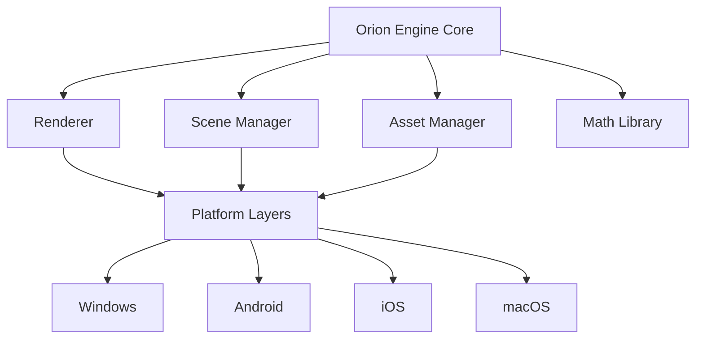

# Orion — Cross-Platform 3D Game Engine


**Orion** is a high-performance, cross-platform 3D game engine written in C++ and powered by OpenGL and OpenGL ES 2.0.

The engine is designed for **space simulation and real-time rendering**, providing a portable core rendering framework with platform-specific wrappers for desktop and mobile environments.

Orion demonstrates a modern graphics architecture capable of rendering dynamic starfields, planetary environments, and particle-driven visual effects.

---

# Overview

Orion provides a modular C++ engine designed to support **real-time 3D simulation environments**, with a focus on space-based scenes and physics.

The system separates the engine into:

* a **portable core engine**
* **platform-specific application layers**
* shared **asset and shader pipelines**

This architecture enables Orion to run across multiple operating systems while maintaining a consistent rendering pipeline.

---

# Key Features

## Cross-Platform Engine Architecture

The Orion engine is designed around a **portable C++ core** with thin platform wrappers.

Supported platforms include:

* Windows desktop
* Android mobile devices
* iOS devices
* macOS systems

Each platform integrates the same core engine through native entry points.

---

## Real-Time 3D Rendering

The engine provides a custom rendering pipeline powered by **OpenGL** and **OpenGL ES 2.0**.

Capabilities include:

* dynamic starfield rendering
* nebula and particle effects
* multi-textured planetary surfaces
* atmospheric visual effects
* real-time lighting and shading

Custom GLSL shaders power advanced graphical effects across platforms.

---

## Advanced Shader System

Orion includes a shader library designed for space simulation visuals.

Examples include:

* starfield generation
* nebula particle rendering
* planetary atmosphere shaders
* multi-layer surface texturing
* particle-based engine and combat effects

These shaders are optimized for both desktop OpenGL and mobile OpenGL ES environments.

---

## Custom Math Library

To support real-time simulation performance, Orion implements a custom math framework.

Components include:

* vector operations
* matrix transformations
* quaternion rotations
* optimized spatial calculations

These systems enable efficient physics and rendering calculations for complex 3D scenes.

---

## Space Simulation Systems

Orion includes specialized simulation classes for space environments.

Examples include:

* spacecraft control systems
* camera and viewpoint management
* planetary objects and celestial bodies
* procedural starfield environments

These systems enable the creation of interactive space simulation scenarios.

---

# System Architecture



The Orion architecture separates core engine logic from platform-specific entry points, enabling portability across multiple operating systems.

---

# Repository Structure

```
OrionEngine/
  Source/
    Renderer
    SceneManager
    AssetManager
    GameObjects

  Shaders/
    GLSL shader library

Orion/
  Windows/
    Win32 entry point and Visual Studio project

  Android/
    Android Studio project with JNI integration

  IOS/
    iOS platform implementation

  OSX/
    macOS platform implementation

  Common/
    Shared 3D models and texture assets
```

---

# Rendering Capabilities

Orion focuses on **high-performance rendering for space environments**.

Supported visual systems include:

* procedural starfields
* nebula particle effects
* multi-texture planetary surfaces
* atmospheric scattering shaders
* dynamic particle systems

These capabilities allow the engine to render visually rich space simulation scenes.

---

# Supported Platforms

Orion supports both desktop and mobile platforms.

### Windows

* Win32 application entry point
* OpenGL rendering
* Visual Studio project support

### Android

* Android NDK integration
* OpenGL ES 2.0 rendering
* Gradle build system

### iOS / macOS

* Xcode projects
* GLKit integration
* OpenGL ES rendering

---

# Build Requirements

To build Orion you will need:

**Compiler**

* Visual Studio
* GCC
* Clang

**Graphics API**

* OpenGL 2.0 or newer
* OpenGL ES 2.0 for mobile platforms

**Development Tools**

* Visual Studio (Windows)
* Android Studio / Gradle (Android)
* Xcode (iOS/macOS)

Optional:

* CMake for cross-platform builds

---

# Project Goals

Orion was designed to explore **high-performance cross-platform graphics architecture** with a focus on:

* portable engine design
* real-time rendering performance
* advanced shader techniques
* simulation-oriented graphics systems

---

# Author

Gordon Pusnik

---

# License

© 2026 Gordon Pusnik. All rights reserved.


